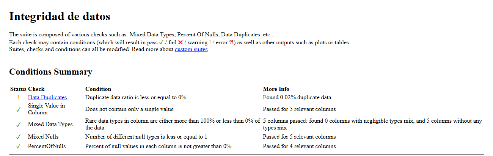
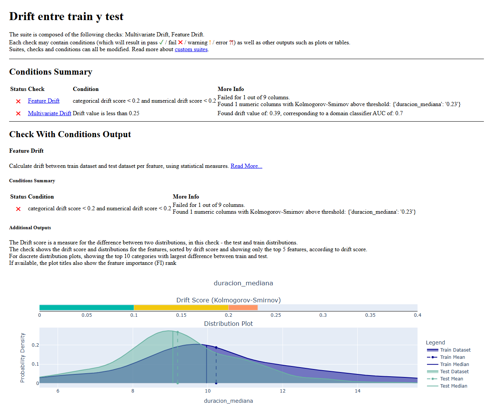
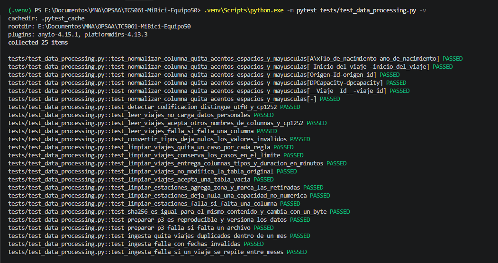

# MiBici-Equipo50

<a target="_blank" href="https://cookiecutter-data-science.drivendata.org/">
    
</a>

Pipeline reproducible para estudiar la demanda y los patrones de uso del sistema de
bicicletas públicas MiBici a nivel estación-hora. El proyecto centraliza ingesta,
variables, entrenamiento, evaluación y tracking de experimentos con MLflow.

## Preguntas del proyecto

1. **P1 — Regresión:** ¿cuántas salidas tendrá cada estación durante la siguiente hora?
2. **P2 — Clasificación:** ¿qué estaciones tendrán riesgo de quedarse sin bicicletas o
   sin anclajes durante la siguiente hora?
3. **P3 — Clustering:** ¿qué grupos de estaciones presentan patrones de uso similares en
   volumen, balance, horario, fin de semana, duración y viajes redondos?

P1 y P2 usan particiones cronológicas y variables rezagadas para evitar información
posterior al momento de predicción. P3 es descriptivo y resume únicamente el periodo de
estudio configurado.

## Datos y versionado

La fuente es el [portal de datos abiertos de MiBici](https://www.mibici.net/es/datos-abiertos),
replicado en una carpeta pública de Google Drive para automatizar la descarga. Se utilizan
los 13 archivos mensuales de septiembre de 2025 a septiembre de 2026 y la nomenclatura de
estaciones de septiembre de 2026. No se procesan atributos personales.

La ingesta detecta codificación, normaliza columnas y tipos, valida fechas e identificadores,
elimina registros no válidos según las reglas documentadas y escribe Parquet con compresión.
`references/manifest_clustering.json`, versionado en Git, registra para cada fuente el número
de filas, tamaño, codificación y SHA-256. Su `version_datos` se calcula con esos hashes y se
registra en MLflow; P1 y P2 registran también sus versiones de datos correspondientes.

## Instalación

```bash
git clone https://github.com/dianitavazquez/TC5061-MiBici-Equipo50.git
cd TC5061-MiBici-Equipo50
python3.12 -m venv .venv
source .venv/bin/activate
make requirements
```

El proyecto requiere Python 3.12 y MLflow 3.17.1.

## Ejecución reproducible

La ingesta completa no requiere descargar archivos manualmente:

```bash
# Descarga los meses seleccionados y la nomenclatura, limpia, convierte a Parquet
# y genera los manifiestos con conteos y hashes.
python -m mibici_ml.dataset prepare

# Construye las variables reutilizables.
python -m mibici_ml.features build-p1
python -m mibici_ml.features build-p3

# Ejecuta los experimentos base y candidatos.
python -m mibici_ml.modeling.train train-p1
python -m mibici_ml.modeling.train train-p2
python -m mibici_ml.modeling.train train-p3
```

La pipeline completa, desde la descarga hasta los tres entrenamientos, se ejecuta con:

```bash
make pipeline
make mlflow-ui
```

La UI queda disponible en <http://127.0.0.1:5000> y los runs se agrupan en el experimento
`mibici-equipo50`.

## Flujo de trabajo con Git y GitHub

Se utiliza **GitHub Flow** con estas reglas:

1. `main` es la rama estable y debe estar protegida contra pushes directos y force-push.
2. Cada cambio comienza desde `main` actualizado en una rama corta con formato
   `<tipo>/<descripcion>-<iniciales>`, por ejemplo `feature/p2-balanceo-aavm`,
   `fix/ingesta-cavm` o `docs/readme-dcvd`.
3. Los commits siguen **Conventional Commits**: `tipo(scope): descripción`. Los tipos
   principales son `feat`, `fix`, `docs`, `refactor`, `test`, `build` y `chore`.
4. La rama se publica y todo cambio entra mediante Pull Request; no se integra código
   directamente en `main`.
5. El PR debe describir objetivo y validaciones, resolver las conversaciones y recibir al
   menos una aprobación de otro integrante. No puede aprobarlo la última persona que hizo
   push.
6. Cada integrante debe abrir al menos un PR y revisar al menos un PR ajeno. Tras aprobarse,
   se integra con **squash merge** y se elimina la rama.

La regla de protección de `main` debe exigir un PR, una aprobación, descartar aprobaciones
obsoletas, requerir aprobación posterior al último push, resolver conversaciones y bloquear
force-pushes y eliminaciones. Se configura en **Settings → Branches → Branch protection
rules** por la persona administradora del repositorio.

Comandos de inicio de un cambio:

```bash
git switch main
git pull --ff-only origin main
git switch -c feature/descripcion-iniciales
```

## Equipo

| Integrante | Rol principal | Pregunta |
|---|---|---|
| Diana Vázquez | Ingesta y modelado de regresión | P1 |
| Anuar Vargas | Clasificación, arquitectura e integración | P2 |
| César Valladares | Ingesta, features y modelado de clustering | P3 |

La responsabilidad de revisión es cruzada: ningún integrante revisa únicamente su propio
trabajo y la evidencia queda registrada en la pestaña **Pull requests** de GitHub.

## Clasificador P2

El baseline predice presión de demanda por falta de bicicletas y de anclajes para cada
estación en la hora siguiente. El diseño, las fuentes, la estrategia temporal y las
métricas están documentados en [docs/p2-classifier-design.md](docs/p2-classifier-design.md).

El análisis exploratorio se encuentra en
[notebooks/1.0-aavm-p2-eda.ipynb](notebooks/1.0-aavm-p2-eda.ipynb). Incluye cobertura,
calidad, demanda por hora, estaciones con más salidas y distribución de capacidades.

```bash
python -m mibici_ml.dataset prepare
python -m mibici_ml.modeling.train train-p2
make mlflow-ui
```

## Pipeline unificada

Los tres problemas comparten configuración, ingesta, construcción de variables, gráficas y
tracking en el experimento `mibici-equipo50`. Para preparar los datos y ejecutar regresión
(P1), clasificación logística (P2) y clustering (P3) en una sola corrida:

```bash
make pipeline
make mlflow-ui
```

También se puede ejecutar cada etapa o modelo por separado:

```bash
python -m mibici_ml.dataset ingest
python -m mibici_ml.dataset prepare-p3
python -m mibici_ml.features build-p1
python -m mibici_ml.features build-p3
python -m mibici_ml.modeling.train train-p1
python -m mibici_ml.modeling.train train-p2
python -m mibici_ml.modeling.train train-p3
```

La implementación centralizada está en `mibici_ml/config.py`, `dataset.py`, `features.py`,
`plots.py` y `modeling/train.py`. El comando `all --no-prepare-data` reutiliza los Parquet ya
generados cuando solo se necesita volver a entrenar.

Los runs siguen la convención `p{n}-{variante}-{modelo}`. P1 compara
`p1-baseline-median` con `p1-candidato-hist-gradient-boosting`; P2 compara regresión
logística sin balanceo (`p2-baseline-logistic-regression`) contra la variante con
`class_weight="balanced"` (`p2-candidato-logistic-regression`).

Si `mlflow.db` reporta una revisión de Alembic desconocida, la terminal está usando
otra versión de MLflow. Verifica `python --version` y `python -m mlflow --version`;
deben indicar Python 3.12 y MLflow 3.17.1, respectivamente. No borres `mlflow.db`, pues
contiene los experimentos registrados.

## Project Organization

```
├── LICENSE            <- Open-source license if one is chosen
├── Makefile           <- Makefile with convenience commands like `make data` or `make train`
├── README.md          <- The top-level README for developers using this project.
├── data
│   ├── external       <- Data from third party sources.
│   ├── interim        <- Intermediate data that has been transformed.
│   ├── processed      <- The final, canonical data sets for modeling.
│   └── raw            <- The original, immutable data dump.
│
├── docs               <- A default mkdocs project; see www.mkdocs.org for details
│
├── models             <- Trained and serialized models, model predictions, or model summaries
│
├── notebooks          <- Jupyter notebooks. Naming convention is a number (for ordering),
│                         the creator's initials, and a short `-` delimited description, e.g.
│                         `1.0-jqp-initial-data-exploration`.
│
├── pyproject.toml     <- Project configuration file with package metadata for 
│                         mibici_ml and configuration for tools like black
│
├── references         <- Data dictionaries, manuals, and all other explanatory materials.
│
├── reports            <- Generated analysis as HTML, PDF, LaTeX, etc.
│   └── figures        <- Generated graphics and figures to be used in reporting
│
├── requirements.txt   <- The requirements file for reproducing the analysis environment, e.g.
│                         generated with `pip freeze > requirements.txt`
│
├── setup.cfg          <- Configuration file for flake8
│
└── mibici_ml   <- Source code for use in this project.
    │
    ├── __init__.py             <- Makes mibici_ml a Python module
    │
    ├── config.py               <- Store useful variables and configuration
    │
    ├── dataset.py              <- Scripts to download or generate data
    │
    ├── features.py             <- Code to create features for modeling
    │
    ├── modeling                
    │   ├── __init__.py 
    │   └── train.py            <- Code to train models
```

--------

## P3: Clustering de estaciones

En esta parte agrupo las estaciones de MiBici según cómo se usan, para ver qué grupos comparten patrones de uso y dónde se ubican. Uso los viajes de septiembre de 2025 a septiembre de 2026 de los [datos abiertos de MiBici](https://www.mibici.net/es/datos-abiertos).

### Cómo correrlo

1. Desde la raíz del repo, con el entorno activado, corro la descarga e ingesta automática:

```bash
python -m mibici_ml.dataset prepare
python -m mibici_ml.features build-p3
python -m mibici_ml.modeling.train train-p3
python -m mibici_ml.modeling.train train-p3 --model candidato --k 3 --k 5 --k 6
make mlflow-ui
```

2. Abro http://127.0.0.1:5000 y entro al experimento `mibici-equipo50`.

### Qué hace cada archivo

1. `mibici_ml/dataset.py` lee los CSV, normaliza columnas, codificación y fechas, limpia los viajes y los guarda en Parquet en `data/interim/`. También escribe `references/manifest_clustering.json` con el SHA-256 de cada archivo y la versión de los datos (`faf7138becd5`). De 4,874,666 viajes quedan 4,718,830.
2. `mibici_ml/features.py` arma el perfil de uso de cada estación (viajes por día activo, salidas por franja horaria, fin de semana, balance, viajes redondos y duración) y lo guarda en `data/processed/`. Quedan 468 estaciones.
3. `mibici_ml/modeling/train.py` entrena el baseline y el modelo candidato y registra cada run en MLflow con sus parámetros, métricas, artefactos, el modelo y las etiquetas `team`, `question` y `git_commit`.
4. `mibici_ml/plots.py` contiene las gráficas de los tres modelos, incluido el mapa de los grupos y el heatmap de su perfil. Se guardan en MLflow y en `reports/figures/`.
5. `notebooks/1.0-cavm-eda-clustering.ipynb` tiene la exploración de las duraciones que usé para definir las reglas de limpieza.
6. `mibici_ml/validation.py` revisa con DeepChecks la integridad de los viajes y del perfil y el drift entre train y test (más abajo explico los resultados).

Todas las rutas, fechas y la semilla están en `mibici_ml/config.py`.

### Datos personales

No cargo `Usuario_Id`, `Genero` ni `Año_de_nacimiento`, los CSV no se suben a Git y solo publico resultados agregados por estación. El portal no publica una licencia abierta, solo sus [términos y condiciones](https://www.mibici.net/es/termino-y-condiciones/) y su [aviso de privacidad](https://www.mibici.net/es/aviso-de-privacidad/), así que uso los datos solo para este proyecto escolar.

### Validación de datos con DeepChecks

Para revisar la calidad de los datos uso [DeepChecks](https://docs.deepchecks.com/). Después de `prepare` y `build-p3` corro:

```bash
python -m mibici_ml.validation p3
```

El comando hace cinco revisiones. Guarda un reporte HTML de cada una en `reports/deepchecks/` (no se sube a Git porque muestra viajes individuales) y un resumen con todos los resultados en `references/validacion_clustering.json`.

1. Integridad de los viajes antes de limpiar: columnas con un solo valor, tipos mezclados, nulos (también nulos escritos de distintas formas) y filas duplicadas.
2. La misma revisión en los viajes ya limpios.
3. La misma revisión en el perfil de estaciones.
4. Drift por viaje entre train (septiembre de 2025 a junio de 2026, 3,497,879 viajes) y test (julio a septiembre de 2026, 1,220,951 viajes) en la hora, el día de la semana, la duración, la estación de origen y si el viaje es redondo.
5. Drift en las 9 variables del perfil. Armo el perfil de cada periodo y comparo solo las 381 estaciones que aparecen en los dos, para que las estaciones nuevas no parezcan drift.

Para el drift, DeepChecks compara cada variable con Kolmogorov-Smirnov o V de Cramér (límite 0.2) y entrena un clasificador que intenta distinguir train de test (límite de 0.25, que equivale a un AUC de 0.625).

| Revisión | Resultado | Qué encontré |
|---|---|---|
| Viajes crudos | Aviso | 758 filas duplicadas (0.016 %), sin nulos ni tipos mezclados. Son las que quita la limpieza. |
| Viajes limpios | Pasa | Sin nulos ni tipos mezclados. Quedan 781 viajes repetidos con distinto `viaje_id` (0.017 %), debajo del límite de 0.1 %. |
| Perfil de estaciones | Pasa | 468 estaciones sin nulos, duplicados ni tipos mezclados. |
| Drift por viaje | Pasa | El puntaje más alto es 0.05 (duración) y el AUC del clasificador es 0.56. |
| Drift del perfil | No pasa | `duracion_mediana` tiene 0.23 y el AUC del clasificador es 0.70. |

Los 781 viajes repetidos tienen la misma hora de inicio y fin y las mismas estaciones. No los quito porque no sé si son un error del sistema o personas que salieron juntas, y casi no mueven el perfil: al quitarlos, `viajes_dia` cambia como máximo 0.13 y la duración mediana 0.03 minutos. Por eso dejé un límite de 0.1 % (`CLUSTERING_MAX_DUPLICATE_RATIO` en `config.py`).

El drift del perfil sí es un hallazgo. De julio a septiembre la duración mediana de los viajes por estación baja de 9.97 a 9.07 minutos y el balance entre salidas y llegadas también cambia un poco (0.16, debajo del límite). Puede ser por la temporada de lluvias o las vacaciones, pero no lo comprobé. Como el modelo de P3 describe el año completo esto no lo invalida, pero si se entrena solo con meses recientes los grupos podrían cambiar, así que conviene repetir esta validación cada vez que se agreguen meses.





Las pruebas de esta validación están en `tests/test_data_validation.py`. Con tablas pequeñas comprueban que las suites sí detectan nulos, nulos escritos de distintas formas, tipos mezclados, duplicados y drift, que el corte de fechas no mezcla los periodos y que solo se comparan estaciones que aparecen en ambos. Las dos últimas revisan los datos reales y se saltan si todavía no se corre la ingesta. Las pruebas del procesamiento de datos (lectura, limpieza y versionado) están en `tests/test_data_processing.py`.

```bash
python -m pytest tests/test_data_processing.py tests/test_data_validation.py -v
```




Uso `deepchecks==0.19.1`, que necesita `setuptools<81` y `plotly==5.24.1`; los tres ya están en `requirements.txt`. Al importarse, DeepChecks manda un aviso anónimo a su servidor, así que lo apago en `mibici_ml/config.py` con `DISABLE_DEEPCHECKS_ANONYMOUS_TELEMETRY`.

### Resultados

Los dos modelos usan K-Means. El baseline solo usa viajes por día y proporción de salidas en fin de semana. El candidato usa las 9 variables de uso. Para poder comparar, calculo las métricas de todos los runs en el mismo espacio (las 9 variables estandarizadas).

| Run | Silhouette (más alto mejor) | Davies-Bouldin (más bajo mejor) | Calinski-Harabasz (más alto mejor) | Grupo más chico |
|---|---|---|---|---|
| p3-baseline-kmeans-k4 | 0.067 | 2.773 | 39.7 | 7.9 % |
| p3-candidato-kmeans-k3 | 0.153 | 1.901 | 83.0 | 27.8 % |
| **p3-candidato-kmeans-k4** | **0.167** | 1.686 | **83.6** | 12.0 % |
| p3-candidato-kmeans-k5 | 0.151 | 1.743 | 75.2 | 9.6 % |
| p3-candidato-kmeans-k6 | 0.157 | 1.629 | 69.7 | 4.9 % |

El candidato es mejor que el baseline en las tres métricas. Elegí k=4 porque tiene la mejor silhouette y el mejor Calinski-Harabasz. Con k=6 el Davies-Bouldin mejora un poco, pero queda un grupo de solo 23 estaciones. La silhouette es baja en general, lo que indica que el uso cambia de forma gradual entre estaciones y no hay cortes muy marcados.

Con k=4 salen estos grupos:

1. Grupo 3 (170 estaciones): las de más uso, casi todas en el centro de Guadalajara.
2. Grupo 0 (132 estaciones): muchas salidas en la mañana y viajes cortos. Están en Zapopan, al norte del centro y hacia Tlaquepaque, y parecen zonas donde vive la gente.
3. Grupo 1 (110 estaciones): más salidas en la tarde, viajes más largos y salen más bicis de las que llegan. Están al poniente del centro.
4. Grupo 2 (56 estaciones): poco uso entre semana, más salidas al mediodía, en fin de semana y viajes redondos, es decir, un uso más recreativo.


