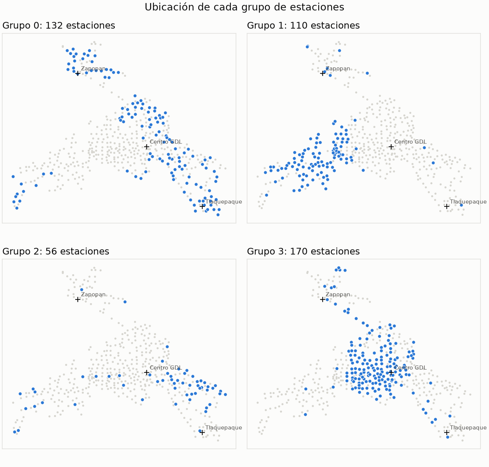
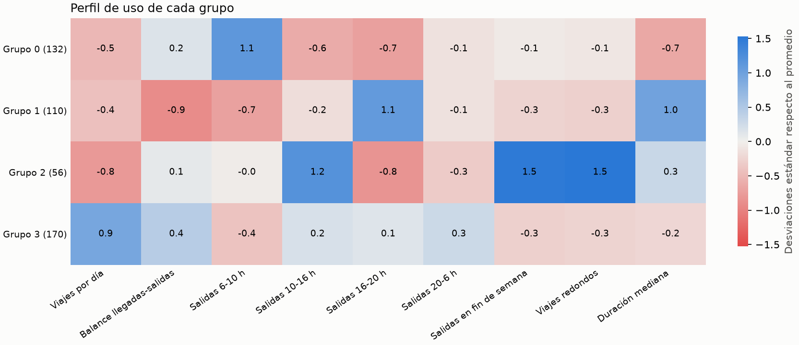

# MiBici-Equipo50

<a target="_blank" href="https://cookiecutter-data-science.drivendata.org/">
    
</a>

Propuesta y base reproducible de proyecto MiBici

## Clasificador P2

El baseline predice presión de demanda por falta de bicicletas y de anclajes para cada
estación en la hora siguiente. El diseño, las fuentes, la estrategia temporal y las
métricas están documentados en [docs/p2-classifier-design.md](docs/p2-classifier-design.md).

El análisis exploratorio se encuentra en
[notebooks/1.0-aavm-p2-eda.ipynb](notebooks/1.0-aavm-p2-eda.ipynb). Incluye cobertura,
calidad, demanda por hora, estaciones con más salidas y distribución de capacidades.

```bash
# Requiere Python 3.12. No utilizar un entorno creado con Python 3.9.
python3.12 -m venv .venv
source .venv/bin/activate
make requirements
python -m mibici_ml.dataset download-drive
python -m mibici_ml.dataset profile
python -m mibici_ml.modeling.train p2-baseline
make mlflow-ui
```

## Pipeline unificada

Los tres problemas comparten configuración, ingesta, construcción de variables, gráficas y
tracking en el experimento `mibici-equipo50`. Para preparar los datos y ejecutar regresión
(P1), clasificación logística (P2) y clustering (P3) en una sola corrida:

```bash
make pipeline
make mlflow-ui
```

También se puede ejecutar cada etapa o modelo por separado:

```bash
python -m mibici_ml.dataset ingest
python -m mibici_ml.dataset prepare-p3
python -m mibici_ml.features build-p1
python -m mibici_ml.features build-p3
python -m mibici_ml.modeling.train train-p1
python -m mibici_ml.modeling.train p2-baseline
python -m mibici_ml.modeling.train train-p3
```

La implementación centralizada está en `mibici_ml/config.py`, `dataset.py`, `features.py`,
`plots.py` y `modeling/train.py`. El comando `all --no-prepare-data` reutiliza los Parquet ya
generados cuando solo se necesita volver a entrenar.

Si `mlflow.db` reporta una revisión de Alembic desconocida, la terminal está usando
otra versión de MLflow. Verifica `python --version` y `python -m mlflow --version`;
deben indicar Python 3.12 y MLflow 3.17.1, respectivamente. No borres `mlflow.db`, pues
contiene los experimentos registrados.

## Project Organization

```
├── LICENSE            <- Open-source license if one is chosen
├── Makefile           <- Makefile with convenience commands like `make data` or `make train`
├── README.md          <- The top-level README for developers using this project.
├── data
│   ├── external       <- Data from third party sources.
│   ├── interim        <- Intermediate data that has been transformed.
│   ├── processed      <- The final, canonical data sets for modeling.
│   └── raw            <- The original, immutable data dump.
│
├── docs               <- A default mkdocs project; see www.mkdocs.org for details
│
├── models             <- Trained and serialized models, model predictions, or model summaries
│
├── notebooks          <- Jupyter notebooks. Naming convention is a number (for ordering),
│                         the creator's initials, and a short `-` delimited description, e.g.
│                         `1.0-jqp-initial-data-exploration`.
│
├── pyproject.toml     <- Project configuration file with package metadata for 
│                         mibici_ml and configuration for tools like black
│
├── references         <- Data dictionaries, manuals, and all other explanatory materials.
│
├── reports            <- Generated analysis as HTML, PDF, LaTeX, etc.
│   └── figures        <- Generated graphics and figures to be used in reporting
│
├── requirements.txt   <- The requirements file for reproducing the analysis environment, e.g.
│                         generated with `pip freeze > requirements.txt`
│
├── setup.cfg          <- Configuration file for flake8
│
└── mibici_ml   <- Source code for use in this project.
    │
    ├── __init__.py             <- Makes mibici_ml a Python module
    │
    ├── config.py               <- Store useful variables and configuration
    │
    ├── dataset.py              <- Scripts to download or generate data
    │
    ├── features.py             <- Code to create features for modeling
    │
    ├── modeling                
    │   ├── __init__.py 
    │   └── train.py            <- Code to train models
```

--------

## P3: Clustering de estaciones

En esta parte agrupo las estaciones de MiBici según cómo se usan, para ver qué grupos comparten patrones de uso y dónde se ubican. Uso los viajes de septiembre de 2025 a septiembre de 2026 de los [datos abiertos de MiBici](https://www.mibici.net/es/datos-abiertos).

### Cómo correrlo

1. Descargo del portal los 13 archivos `datos_abiertos_2025_09.csv` a `datos_abiertos_2026_09.csv` y `nomenclatura_2026_09.csv`, y los pongo en `data/raw/`.
2. Desde la raíz del repo, con el entorno activado, corro:

```bash
python -m mibici_ml.dataset prepare-p3
python -m mibici_ml.features build-p3
python -m mibici_ml.modeling.train train-p3
python -m mibici_ml.modeling.train train-p3 --model candidato --k 3 --k 5 --k 6
make mlflow-ui
```

3. Abro http://127.0.0.1:5000 y entro al experimento `mibici-equipo50`.

### Qué hace cada archivo

1. `mibici_ml/dataset.py` lee los CSV, normaliza columnas, codificación y fechas, limpia los viajes y los guarda en Parquet en `data/interim/`. También escribe `references/manifest_clustering.json` con el SHA-256 de cada archivo y la versión de los datos (`faf7138becd5`). De 4,874,666 viajes quedan 4,718,830.
2. `mibici_ml/features.py` arma el perfil de uso de cada estación (viajes por día activo, salidas por franja horaria, fin de semana, balance, viajes redondos y duración) y lo guarda en `data/processed/`. Quedan 468 estaciones.
3. `mibici_ml/modeling/train.py` entrena el baseline y el modelo candidato y registra cada run en MLflow con sus parámetros, métricas, artefactos, el modelo y las etiquetas `team`, `question` y `git_commit`.
4. `mibici_ml/plots.py` contiene las gráficas de los tres modelos, incluido el mapa de los grupos y el heatmap de su perfil. Se guardan en MLflow y en `reports/figures/`.
5. `notebooks/1.0-cavm-eda-clustering.ipynb` tiene la exploración de las duraciones que usé para definir las reglas de limpieza.

Todas las rutas, fechas y la semilla están en `mibici_ml/config.py`.

### Datos personales

No cargo `Usuario_Id`, `Genero` ni `Año_de_nacimiento`, los CSV no se suben a Git y solo publico resultados agregados por estación. El portal no publica una licencia abierta, solo sus [términos y condiciones](https://www.mibici.net/es/termino-y-condiciones/) y su [aviso de privacidad](https://www.mibici.net/es/aviso-de-privacidad/), así que uso los datos solo para este proyecto escolar.

### Resultados

Los dos modelos usan K-Means. El baseline solo usa viajes por día y proporción de salidas en fin de semana. El candidato usa las 9 variables de uso. Para poder comparar, calculo las métricas de todos los runs en el mismo espacio (las 9 variables estandarizadas).

| Run | Silhouette (más alto mejor) | Davies-Bouldin (más bajo mejor) | Calinski-Harabasz (más alto mejor) | Grupo más chico |
|---|---|---|---|---|
| p3-baseline-kmeans-k4 | 0.067 | 2.773 | 39.7 | 7.9 % |
| p3-candidato-kmeans-k3 | 0.153 | 1.901 | 83.0 | 27.8 % |
| **p3-candidato-kmeans-k4** | **0.167** | 1.686 | **83.6** | 12.0 % |
| p3-candidato-kmeans-k5 | 0.151 | 1.743 | 75.2 | 9.6 % |
| p3-candidato-kmeans-k6 | 0.157 | 1.629 | 69.7 | 4.9 % |

El candidato es mejor que el baseline en las tres métricas. Elegí k=4 porque tiene la mejor silhouette y el mejor Calinski-Harabasz. Con k=6 el Davies-Bouldin mejora un poco, pero queda un grupo de solo 23 estaciones. La silhouette es baja en general, lo que indica que el uso cambia de forma gradual entre estaciones y no hay cortes muy marcados.

Con k=4 salen estos grupos:

1. Grupo 3 (170 estaciones): las de más uso, casi todas en el centro de Guadalajara.
2. Grupo 0 (132 estaciones): muchas salidas en la mañana y viajes cortos. Están en Zapopan, al norte del centro y hacia Tlaquepaque, y parecen zonas donde vive la gente.
3. Grupo 1 (110 estaciones): más salidas en la tarde, viajes más largos y salen más bicis de las que llegan. Están al poniente del centro.
4. Grupo 2 (56 estaciones): poco uso entre semana, más salidas al mediodía, en fin de semana y viajes redondos, es decir, un uso más recreativo.




