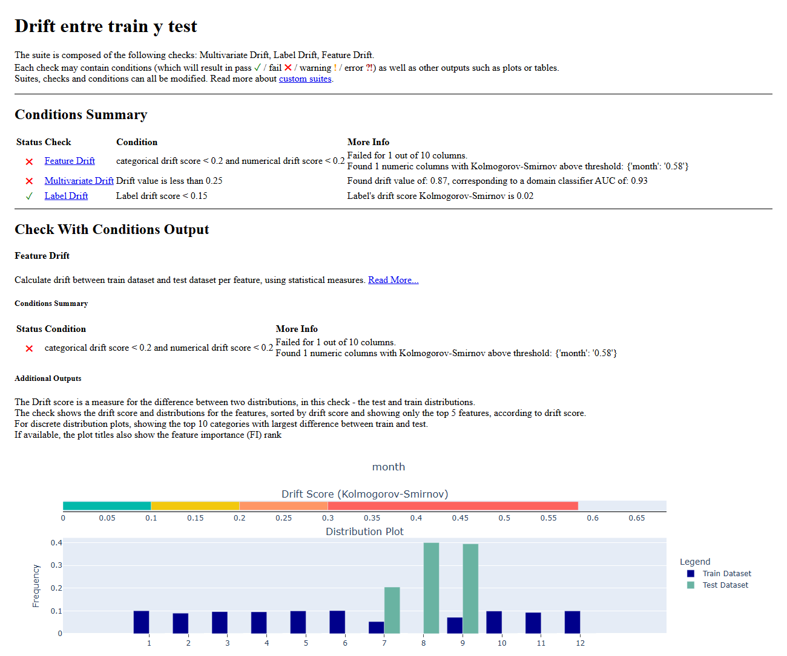
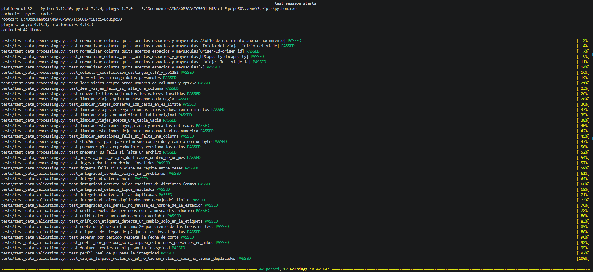
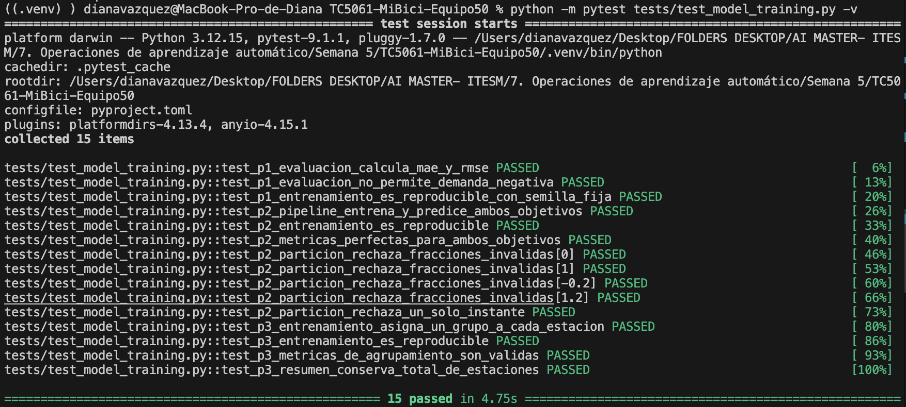
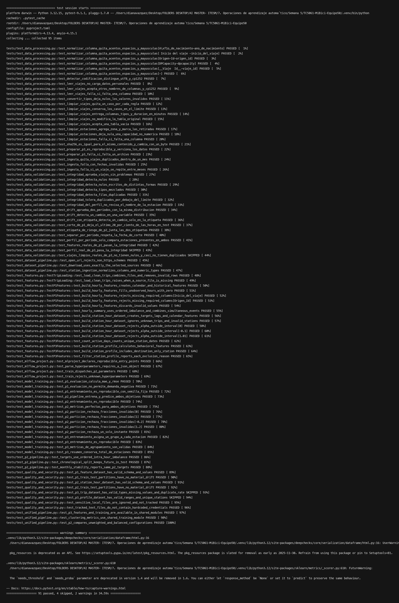
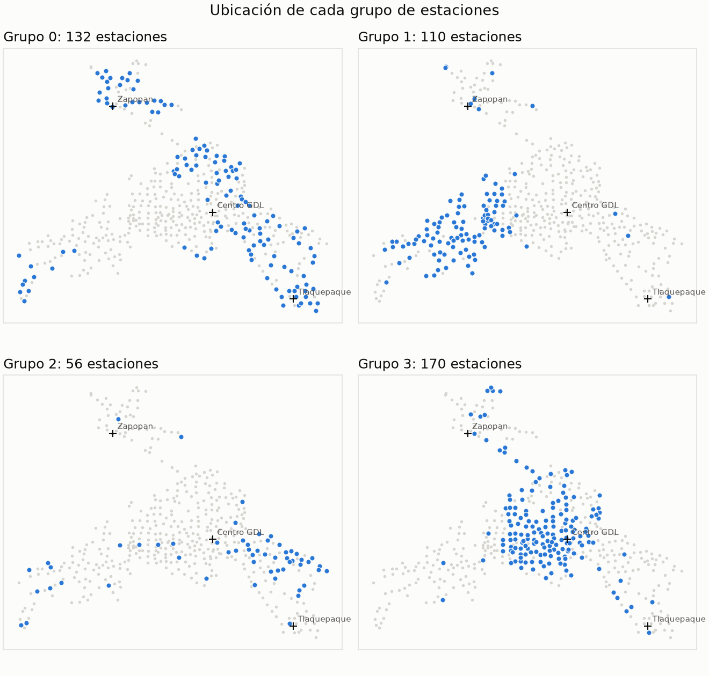
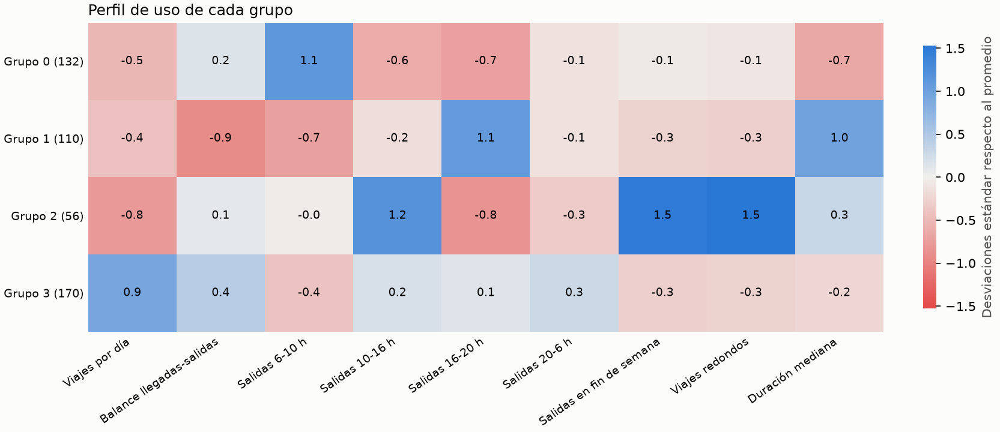

# MiBici-Equipo50

<a target="_blank" href="https://cookiecutter-data-science.drivendata.org/">
    
</a>

Pipeline reproducible para estudiar la demanda y los patrones de uso del sistema de
bicicletas públicas MiBici a nivel estación-hora. El proyecto centraliza ingesta,
variables, entrenamiento, evaluación y tracking de experimentos con MLflow.

## Equipo

| Integrante | Rol principal | Pregunta |
|---|---|---|
| Diana Vázquez | Ingesta y modelado de regresión | P1 |
| Anuar Vargas | Clasificación, arquitectura e integración | P2 |
| César Valladares | Ingesta, features y modelado de clustering | P3 |

La responsabilidad de revisión es cruzada: ningún integrante revisa únicamente su propio
trabajo y la evidencia queda registrada en la pestaña **Pull requests** de GitHub.

## Preguntas del proyecto

1. **P1 — Regresión:** ¿cuántas salidas tendrá cada estación durante la siguiente hora?
2. **P2 — Clasificación:** ¿qué estaciones tendrán riesgo de quedarse sin bicicletas o
   sin anclajes durante la siguiente hora?
3. **P3 — Clustering:** ¿qué grupos de estaciones presentan patrones de uso similares en
   volumen, balance, horario, fin de semana, duración y viajes redondos?

P1 y P2 usan particiones cronológicas y variables rezagadas para evitar información
posterior al momento de predicción. P3 es descriptivo y resume únicamente el periodo de
estudio configurado.

## Datos y versionado

La fuente es el [portal de datos abiertos de MiBici](https://www.mibici.net/es/datos-abiertos),
replicado en una carpeta pública de Google Drive para automatizar la descarga. Se utilizan
los 13 archivos mensuales de septiembre de 2025 a septiembre de 2026 y la nomenclatura de
estaciones de septiembre de 2026. No se procesan atributos personales.

La ingesta detecta codificación, normaliza columnas y tipos, valida fechas e identificadores,
elimina registros no válidos según las reglas documentadas y escribe Parquet con compresión.
`references/manifest_clustering.json`, versionado en Git, registra para cada fuente el número
de filas, tamaño, codificación y SHA-256. Su `version_datos` se calcula con esos hashes y se
registra en MLflow; P1 y P2 registran también sus versiones de datos correspondientes.

## Instalación

```bash
git clone https://github.com/dianitavazquez/TC5061-MiBici-Equipo50.git
cd TC5061-MiBici-Equipo50
python3.12 -m venv .venv
source .venv/bin/activate
make requirements
```

El proyecto requiere Python 3.12 y MLflow 3.17.1.
`cryptography` se fija en 44.0.3 porque incluye wheels para Python 3.12 tanto en macOS
Intel como Apple Silicon; así la instalación no requiere compilar Rust/OpenSSL localmente.

### Variables de entorno y credenciales

La configuración local se carga desde variables de entorno. Como punto de partida, copia la
plantilla versionada y modifica únicamente tu archivo local:

```bash
cp .env.example .env
```
### Preparación, validación de datos y entrenamiento

```bash
# Descarga los meses seleccionados y la nomenclatura, limpia, convierte a Parquet
# y genera los manifiestos con conteos y hashes.
python -m mibici_ml.dataset prepare

# Construye las variables reutilizables.
python -m mibici_ml.features build-p1
python -m mibici_ml.features build-p3

# Valida con DeepChecks los datos de las tres preguntas.
python -m mibici_ml.validation all

# Ejecuta los experimentos base y candidatos.
python -m mibici_ml.modeling.train train-p1
python -m mibici_ml.modeling.train train-p2
python -m mibici_ml.modeling.train train-p3
```

`.env`, variantes locales, llaves privadas y archivos comunes de credenciales están excluidos
por `.gitignore`. No agregues tokens, contraseñas, datos personales ni credenciales reales al
repositorio. `.env.example` debe contener solamente nombres de variables y valores públicos o
de ejemplo.

## Pruebas, calidad de datos y seguridad

Ejecuta toda la suite desde la raíz del repositorio con el entorno virtual activo:

```bash
python -m pytest -q
# Equivalente:
make test
```

Las pruebas unitarias de feature engineering para P1, P2 y P3 están en
`tests/test_features.py`. Los chequeos de `tests/test_quality_and_security.py` validan:

- columnas requeridas, tipos, valores faltantes y rangos permitidos;
- unicidad de llaves y proporción de registros duplicados;
- separación cronológica y drift entre entrenamiento y prueba mediante PSI, con umbral 0.25;
- ausencia de archivos sensibles versionados y de credenciales embebidas.

Los chequeos de datasets usan los artefactos locales generados y se omiten si todavía no
existen. P2 no persiste su panel estación-hora, por lo que el chequeo lo construye con un mes
representativo de viajes reales y valida su esquema, targets, duplicados, corte cronológico y
drift. Para ejecutar los chequeos con datos reales, genera primero la ingesta y las features y
después corre:

```bash
mlflow run . -e ingest
mlflow run . -e features -P question=p1
mlflow run . -e features -P question=p3
python -m pytest tests/test_quality_and_security.py -q
# Equivalente:
make quality
```

El análisis estático de seguridad se realiza con Bandit, fijado en `requirements.txt`:

```bash
python -m bandit -r mibici_ml -ll
# Equivalente:
make security
```

Para ejecutar pruebas, formato/lint y seguridad en una sola operación:

```bash
make checks
```

## Ejecución reproducible con MLflow Project

Todas las corridas de esta entrega se lanzan desde `MLproject`. `python_env.yaml` usa Python
3.12.7 y el mismo `requirements.txt` con dependencias fijas; MLflow crea y reutiliza ese
entorno automáticamente.

### 1. Servidor local de tracking y Model Registry

Después de instalar las dependencias, inicia el servidor desde la raíz del repositorio en
una terminal y déjalo activo:

```bash
python -m mlflow server \
  --backend-store-uri sqlite:///mlflow.db \
  --default-artifact-root ./mlartifacts \
  --host 127.0.0.1 \
  --port 5050
```

La base SQLite respalda el tracking y el Model Registry; `mlflow.db`, `mlruns/` y
`mlartifacts/` son archivos locales ignorados por Git. La UI queda disponible en
<http://127.0.0.1:5050>.

En una segunda terminal, activa el entorno y apunta todos los clientes al servidor:

```bash
source .venv/bin/activate
export MLFLOW_TRACKING_URI=http://127.0.0.1:5050
export MLFLOW_EXPERIMENT_NAME=mibici-equipo50
```

La segunda variable hace que la corrida creada por `mlflow run` y los artefactos del
entrenamiento queden en el mismo experimento configurado por el proyecto.

También se puede iniciar el mismo servidor con `make mlflow-ui`.

### 2. Ingesta y features

La ingesta descarga los archivos seleccionados, genera perfiles y manifiestos con hashes,
limpia los datos y escribe los Parquet. No requiere descargas manuales:

```bash
mlflow run . -e ingest
mlflow run . -e features -P question=p1
mlflow run . -e features -P question=p3
```

P2 construye sus variables estación-hora durante el entrenamiento, por lo que no necesita
una etapa de features persistida.

### 3. Modelos elegidos para P1, P2 y P3

El parámetro `hyperparameters` es un objeto JSON. Si se omite, el código toma los valores
centrales de `mibici_ml/config.py`; el `MLproject` no repite rutas, fechas ni semillas.
Desde un clon limpio, después de ejecutar la ingesta y las features anteriores, los modelos
elegidos se reproducen con:

```bash
# P1: HistGradientBoostingRegressor candidato
mlflow run . -e train -P question=p1 -P model=candidato \
  -P 'hyperparameters={"max_iter":100,"learning_rate":0.1,"max_leaf_nodes":31,"l2_regularization":1.0}'

# P2: regresión logística multisalida con clases balanceadas
mlflow run . -e train -P question=p2 -P model=candidato \
  -P 'hyperparameters={"c":1.0,"class_weight":"balanced","max_iter":1000}'

# P3: K-Means candidato con cuatro grupos
mlflow run . -e train -P question=p3 -P model=candidato \
  -P 'hyperparameters={"k":4,"n_init":10}'
```

Para usar todos los valores por defecto basta, por ejemplo, con:

```bash
mlflow run . -e train -P question=p2 -P model=candidato
```

Los runs se agrupan en el experimento `mibici-equipo50`. Para P2 y P3 se admiten
`baseline`, `candidato-1`, `candidato-2` y `candidato-3`; `candidato` se conserva como alias
del primero. Parámetros desconocidos o preguntas distintas de `p1`, `p2` y `p3` terminan con
un error explícito.

## Despliegue con Docker

La API con FastAPI y los modelos del proyecto se empaquetan en una imagen de Docker para que el servicio funcione igual en cualquier máquina. Yo lo probé con Docker Desktop 29 en Windows. El `Dockerfile` sigue el estándar OCI, así que también funciona con Podman cambiando `docker` por `podman` en los comandos.

### Estrategia de despliegue

Elegí inferencia en tiempo real: la API responde cada petición en el momento. P1 y P2 predicen la siguiente hora, así que una predicción por lotes llegaría tarde para el equipo de rebalanceo, y P3 solo consulta a qué grupo pertenece un perfil de estación. Los tres modelos son de scikit-learn y predicen en milisegundos, por lo que no hace falta una cola ni procesar por lotes.

Para recuperar los modelos del Model Registry elegí la opción de empaquetarlos dentro de la imagen, en lugar de leerlos al arrancar con `MLFLOW_TRACKING_URI`. Antes del build, un script descarga cada modelo por su nombre y el alias `champion`, y el `Dockerfile` copia esa carpeta. Lo decidí así por dos razones:

1. El contenedor no depende de un servidor de MLflow encendido, así que funciona en cualquier máquina.
2. Nuestro tracking guarda los artefactos con rutas locales de Windows (por ejemplo `file:E:/.../mlruns/1`), que un contenedor Linux no puede leer aunque llegue al servidor.

| Pregunta | Modelo en el registry | Alias |
|---|---|---|
| P2 | `mibici-equipo50-p2-riesgo` | `champion` |
| P3 | `mibici-equipo50-p3-grupos` | `champion` |

P1 (`mibici-equipo50-p1-demanda`) se agrega en cuanto su registro esté en `main`: basta con sumarlo a `SERVING_MODELS` en `mibici_ml/config.py` y repetir los pasos 1 y 2.

### 1. Descargar los modelos del registry

Primero los modelos deben estar registrados en tu máquina: P2 con `python -m mibici_ml.modeling.train search-p2` y P3 con los comandos de "Experimentos y Model Registry" de la sección de P3, que terminan con `p3-register`. Después se descargan con:

```bash
python -m mibici_ml.modeling.export_models --tracking-uri sqlite:///mlflow.db
```

Si el servidor de MLflow está encendido, también funciona sin `--tracking-uri`, porque toma `MLFLOW_TRACKING_URI`. El script guarda cada modelo en `models/serving/<pregunta>/` y escribe `models/serving/modelos.json` con el nombre, alias, versión, run y commit de cada uno, para saber exactamente qué versión trae la imagen. Esa carpeta está en `.gitignore`, porque los modelos no se suben a Git.

### 2. Construir la imagen

```bash
docker build -t mibici-api:1.0 .
```

La imagen parte de `python:3.12.10-slim`, instala `requirements.txt`, copia el paquete `mibici_ml` y los modelos de `models/serving/`, y corre la API con un usuario sin privilegios. El `.dockerignore` deja fuera los datos, las bases de MLflow, `.env`, `.secrets/`, las pruebas y los notebooks, así que nada de eso llega a la imagen. La primera vez tarda unos 2 minutos y la imagen pesa alrededor de 1.8 GB.

Si tu antivirus revisa las conexiones HTTPS (a mí me pasó con Norton), `pip` falla dentro del build con `CERTIFICATE_VERIFY_FAILED`, porque el contenedor no conoce el certificado del antivirus. En ese caso exporta el certificado raíz a `.secrets/`, que Git y Docker ignoran, y pásalo como secreto. Solo se usa durante la instalación y no queda guardado en la imagen. En PowerShell:

```powershell
New-Item -ItemType Directory -Force .secrets | Out-Null
$c = Get-ChildItem Cert:\LocalMachine\Root | Where-Object Subject -like "*Norton Web/Mail Shield Root*" | Select-Object -First 1
"-----BEGIN CERTIFICATE-----`n$([Convert]::ToBase64String($c.RawData, 'InsertLineBreaks'))`n-----END CERTIFICATE-----" | Out-File .secrets\norton_root.pem -Encoding ascii
docker build --secret id=ca_extra,src=.secrets/norton_root.pem -t mibici-api:1.0 .
```

### 3. Levantar el contenedor

```bash
docker run -d --name mibici-api -p 8000:8000 mibici-api:1.0
docker ps
docker logs mibici-api
```

La API queda en <http://127.0.0.1:8000> y su documentación interactiva en <http://127.0.0.1:8000/docs>. La imagen tiene un healthcheck que consulta `GET /health` cada 30 segundos; cuando todo está bien, `docker ps` muestra el contenedor como `healthy`. Para detenerlo y borrarlo:

```bash
docker stop mibici-api
docker rm mibici-api
```

### 4. Consumir la API

<!-- Pendiente: ejemplo de petición y respuesta con la API final y la captura del contenedor respondiendo. -->

## Flujo de trabajo con Git y GitHub

Se utiliza **GitHub Flow** con estas reglas:

1. `main` es la rama estable y debe estar protegida contra pushes directos y force-push.
2. Cada cambio comienza desde `main` actualizado en una rama corta con formato
   `<tipo>/<descripcion>-<iniciales>`, por ejemplo `feature/p2-balanceo-aavm`,
   `fix/ingesta-cavm` o `docs/readme-dcvd`.
3. Los commits siguen **Conventional Commits**: `tipo(scope): descripción`. Los tipos
   principales son `feat`, `fix`, `docs`, `refactor`, `test`, `build` y `chore`.
4. La rama se publica y todo cambio entra mediante Pull Request; no se integra código
   directamente en `main`.
5. El PR debe describir objetivo y validaciones, resolver las conversaciones y recibir al
   menos una aprobación de otro integrante. No puede aprobarlo la última persona que hizo
   push.
6. Cada integrante debe abrir al menos un PR y revisar al menos un PR ajeno. Tras aprobarse,
   se integra con **squash merge** y se elimina la rama.

La regla de protección de `main` debe exigir un PR, una aprobación, descartar aprobaciones
obsoletas, requerir aprobación posterior al último push, resolver conversaciones y bloquear
force-pushes y eliminaciones. Se configura en **Settings → Branches → Branch protection
rules** por la persona administradora del repositorio.

Comandos de inicio de un cambio:

```bash
git switch main
git pull --ff-only origin main
git switch -c feature/descripcion-iniciales
```

## Pipeline unificada

Los tres problemas comparten configuración, ingesta, construcción de variables, gráficas y
tracking en el experimento `mibici-equipo50`. Cada etapa se ejecuta mediante el proyecto:

```bash
mlflow run . -e ingest
mlflow run . -e features -P question=p1
mlflow run . -e train -P question=p1 -P model=candidato
mlflow run . -e p2-search
mlflow run . -e features -P question=p3
mlflow run . -e train -P question=p3 -P model=candidato
```

La implementación centralizada está en `mibici_ml/config.py`, `dataset.py`, `features.py`,
`plots.py`, `project.py` y `modeling/train.py`.

Los runs siguen la convención `p{n}-{variante}-{modelo}`. P1 compara
`p1-baseline-median` con `p1-candidato-hist-gradient-boosting`; P2 compara regresión
logística sin balanceo (`p2-baseline-logistic-regression`) contra la variante con
`class_weight="balanced"` (`p2-candidato-logistic-regression`).

Si `mlflow.db` reporta una revisión de Alembic desconocida, la terminal está usando
otra versión de MLflow. Verifica `python --version` y `python -m mlflow --version`;
deben indicar Python 3.12 y MLflow 3.17.1, respectivamente. No borres `mlflow.db`, pues
contiene los experimentos registrados.

## Validación de datos con DeepChecks

Para revisar la calidad de todos los datos del proyecto uso [DeepChecks](https://docs.deepchecks.com/). Después de `prepare`, `build-p1` y `build-p3` corro:

```bash
python -m mibici_ml.validation all
```

La corrida completa tarda unos 3 minutos. También se puede correr un solo grupo cambiando `all` por `raw`, `p1`, `p2` o `p3`. Cada grupo guarda sus reportes HTML en `reports/deepchecks/<grupo>/` (no se suben a Git porque muestran viajes individuales) y un resumen con el resultado y los números de cada condición en `references/validacion/<grupo>.json`.

Lo que revisa cada grupo:

1. `raw`: los 13 CSV mensuales que usan las tres preguntas, sin columnas personales y antes de limpiar.
2. `p1`: los viajes que deja `ingest`, las features por estación y hora, y el drift entre train y test con el mismo corte de `train_p1` (el último 20 % de las horas, desde el 15 de julio de 2026).
3. `p2`: los viajes que deja `load_clean_trips`, el panel estación-hora que arma `train_p2` y el drift con su mismo corte (desde el 20 de julio de 2026). Para medir el drift de la etiqueta junto `risk_no_bikes` y `risk_no_docks` en una sola categoría.
4. `p3`: los viajes limpios, el perfil de estaciones y el drift entre septiembre de 2025 a junio de 2026 (train) y julio a septiembre de 2026 (test), por viaje y en el perfil de las 381 estaciones que aparecen en los dos periodos.

En la integridad reviso columnas con un solo valor, tipos mezclados, nulos (también nulos escritos de distintas formas) y filas duplicadas. En el drift, DeepChecks compara cada variable con Kolmogorov-Smirnov o V de Cramér (límite 0.2), compara la etiqueta (límite 0.15) y entrena un clasificador que intenta distinguir train de test (límite de 0.25, que equivale a un AUC de 0.625). Los duplicados los marca como aviso y no como falla.

| Datos | Revisión | Resultado | Qué encontré |
|---|---|---|---|
| Crudos | Integridad | Aviso | 4,874,666 viajes sin nulos ni tipos mezclados, pero con 758 filas duplicadas (0.016 %). |
| P1 | Integridad de viajes | Pasa | 4,873,908 viajes sin nulos ni duplicados. |
| P1 | Integridad de features | Pasa | 3,629,494 filas sin nulos, duplicados ni tipos mezclados. |
| P1 | Drift | No pasa | Solo `month` (0.58). El clasificador separa train y test con AUC de 0.93 usando únicamente el mes. La etiqueta casi no cambia (0.02). |
| P2 | Integridad de viajes | Aviso | 4,558,080 viajes sin nulos, pero con 0.03 % de filas repetidas. |
| P2 | Integridad del panel | Pasa | 3,448,100 filas sin nulos, duplicados ni tipos mezclados. |
| P2 | Drift | No pasa | Solo `month_sin` (0.53) y `month_cos` (0.82). El clasificador llega a AUC de 0.99 solo con el mes. La etiqueta no cambia (0.00). |
| P3 | Integridad de viajes | Pasa | Sin nulos. Quedan 781 viajes repetidos con distinto `viaje_id` (0.017 %), debajo del límite de 0.1 %. |
| P3 | Integridad del perfil | Pasa | 468 estaciones sin nulos, duplicados ni tipos mezclados. |
| P3 | Drift por viaje | Pasa | El puntaje más alto es 0.05 (duración) y el AUC es 0.56. |
| P3 | Drift del perfil | No pasa | `duracion_mediana` tiene 0.23 y el AUC es 0.70. |

Lo que encontré:

1. Los 758 duplicados de los crudos los quitan las ingestas de P1 y P3. P2 lee los CSV directo con `load_clean_trips`, que no quita duplicados, y por eso le quedan 1,484 filas repetidas. Son muy pocas frente a 4.56 millones de viajes, pero conviene agregar ese paso.
2. Los 781 viajes repetidos de P3 tienen la misma hora de inicio y fin y las mismas estaciones, pero distinto `viaje_id`. No los quito porque no sé si son un error del sistema o personas que salieron juntas, y casi no mueven el perfil: al quitarlos, `viajes_dia` cambia como máximo 0.13 y la duración mediana 0.03 minutos. Por eso dejé un límite de 0.1 % (`CLUSTERING_MAX_DUPLICATE_RATIO` en `config.py`).
3. En P1 y P2 el drift viene solo del mes. Con el corte por fecha, el test queda entre mediados de julio y septiembre de 2026; en train agosto no aparece y julio y septiembre casi no (se ve en la captura de P1). Las demás variables y la etiqueta no cambian, así que el modelo se evalúa en meses que casi no vio al entrenar. Lo dejo documentado para que los responsables de P1 y P2 decidan si conservan la variable del mes.
4. En P3 sí cambia el comportamiento de las estaciones. De julio a septiembre la duración mediana de los viajes por estación baja de 9.97 a 9.07 minutos y el balance entre salidas y llegadas también cambia un poco (0.16, debajo del límite). Puede ser por la temporada de lluvias o las vacaciones, pero no lo comprobé. Como el modelo de P3 describe el año completo esto no lo invalida, pero si se entrena solo con meses recientes los grupos podrían cambiar.

Conviene repetir esta validación cada vez que se agreguen meses.





### Pruebas de los datos

Las pruebas de esta validación están en `tests/test_data_validation.py`. Con tablas pequeñas comprueban que las suites sí detectan nulos, nulos escritos de distintas formas, tipos mezclados, duplicados, drift en las variables y drift solo en la etiqueta. También comprueban que el corte de P1 es el mismo de `train_p1`, que la etiqueta de P2 junta bien sus dos etiquetas y que en P3 el corte de fechas no mezcla periodos y solo se comparan estaciones que aparecen en ambos. Las tres últimas revisan los datos reales de P1 y P3 y se saltan si todavía no se corre la ingesta. Las pruebas del procesamiento de datos (lectura, limpieza y versionado) están en `tests/test_data_processing.py`.

```bash
python -m pytest tests/test_data_processing.py tests/test_data_validation.py -v
```



Uso `deepchecks==0.19.1`, que necesita `setuptools<81` y `plotly==5.24.1`; los tres ya están en `requirements.txt`. Al importarse, DeepChecks manda un aviso anónimo a su servidor, así que lo apago en `mibici_ml/config.py` con `DISABLE_DEEPCHECKS_ANONYMOUS_TELEMETRY`.

### Pruebas unitarias de entrenamiento P1, P2 y P3

Las pruebas unitarias de entrenamiento están implementadas con **PyTest** en `tests/test_model_training.py` y cubren los tres problemas del proyecto:

- **P1 — Regresión:** validación de funciones de entrenamiento y evaluación de modelos de predicción de demanda.
- **P2 — Clasificación:** validación de componentes del entrenamiento y evaluación de los modelos de riesgo.
- **P3 — Clustering:** validación de funciones de agrupamiento y evaluación de modelos.

Estas pruebas utilizan datos sintéticos y no requieren descargar los archivos CSV originales de MiBici ni iniciar un servidor MLflow.

#### Ejecución

Desde la raíz del repositorio, con el entorno virtual activado y las dependencias instaladas:

```bash
python -m pytest tests/test_model_training.py -v
```

Para ejecutar todas las pruebas del proyecto:

```bash
python -m pytest tests/ -v
```

#### Resultados de la ejecución

| Validación | Resultado |
|---|---|
| Pruebas unitarias de entrenamiento | 15 passed |
| Suite completa | 91 passed, 4 skipped, 2 warnings |
| Dependencias (`pip check`) | No broken requirements found |

Las cuatro pruebas omitidas corresponden a validaciones que requieren artefactos de datos no disponibles en el entorno de ejecución.

#### Evidencias

**Pruebas unitarias de entrenamiento**



**Suite completa de pruebas**



## Project Organization

```
├── LICENSE            <- Open-source license if one is chosen
├── Makefile           <- Makefile with convenience commands like `make data` or `make train`
├── README.md          <- The top-level README for developers using this project.
├── data
│   ├── external       <- Data from third party sources.
│   ├── interim        <- Intermediate data that has been transformed.
│   ├── processed      <- The final, canonical data sets for modeling.
│   └── raw            <- The original, immutable data dump.
│
├── docs               <- A default mkdocs project; see www.mkdocs.org for details
│
├── models             <- Trained and serialized models, model predictions, or model summaries
│
├── notebooks          <- Jupyter notebooks. Naming convention is a number (for ordering),
│                         the creator's initials, and a short `-` delimited description, e.g.
│                         `1.0-jqp-initial-data-exploration`.
│
├── pyproject.toml     <- Project configuration file with package metadata for 
│                         mibici_ml and configuration for tools like black
│
├── references         <- Data dictionaries, manuals, and all other explanatory materials.
│
├── reports            <- Generated analysis as HTML, PDF, LaTeX, etc.
│   └── figures        <- Generated graphics and figures to be used in reporting
│
├── requirements.txt   <- The requirements file for reproducing the analysis environment, e.g.
│                         generated with `pip freeze > requirements.txt`
│
├── setup.cfg          <- Configuration file for flake8
│
└── mibici_ml   <- Source code for use in this project.
    │
    ├── __init__.py             <- Makes mibici_ml a Python module
    │
    ├── config.py               <- Store useful variables and configuration
    │
    ├── dataset.py              <- Scripts to download or generate data
    │
    ├── features.py             <- Code to create features for modeling
    │
    ├── modeling                
    │   ├── __init__.py 
    │   └── train.py            <- Code to train models
```

--------

## Clasificador P2

El baseline predice presión de demanda por falta de bicicletas y de anclajes para cada
estación en la hora siguiente. El diseño, las fuentes, la estrategia temporal y las
métricas están documentados en [docs/p2-classifier-design.md](docs/p2-classifier-design.md).

El análisis exploratorio se encuentra en
[notebooks/1.0-aavm-p2-eda.ipynb](notebooks/1.0-aavm-p2-eda.ipynb). Incluye cobertura,
calidad, demanda por hora, estaciones con más salidas y distribución de capacidades.

```bash
mlflow run . -e ingest
mlflow run . -e p2-search
```

La comparación definitiva de P2 se ejecuta con un solo comando:

```bash
mlflow run . -e p2-search
```

La corrida padre `p2-logistic-class-weight-search` tiene `stage_of_work=search` y contiene
cuatro corridas hijas sobre exactamente el mismo corte cronológico: el baseline sin pesos y
tres candidatos con `class_weight` balanceado, peso positivo 2× y peso positivo 5×. Cada
hija registra las métricas P2 originales, estabilidad mensual, tiempo de ajuste e inferencia,
el modelo con firma y ejemplo, lineage del conjunto agregado estación-hora, manifiesto,
configuración, matrices de confusión y curvas precisión-recall. El padre guarda la tabla
comparativa y la justificación del modelo marcado con `selected_for_production=true`.

La búsqueda ejecutada sobre la versión de datos `928ac1753461` produjo:

| Modelo | Peso clase positiva | Macro-F1 | F1 sin bicis | F1 sin anclajes | Mínimo macro-F1 mensual | Ajuste (s) |
|---|---:|---:|---:|---:|---:|---:|
| Baseline | 1× | 0.1474 | 0.1408 | 0.1540 | 0.1404 | 37.0 |
| Candidato 1 | balanced | 0.0253 | 0.0198 | 0.0308 | 0.0212 | 168.5 |
| Candidato 2 | 2× | 0.1684 | 0.1481 | 0.1886 | 0.1601 | 41.7 |
| **Candidato 3** | **5×** | **0.2068** | **0.1718** | **0.2418** | **0.1936** | 85.6 |

Se seleccionó el candidato 3: mejora macro-F1 en 0.0594 puntos (40.3% relativo) frente al
baseline y su peor mes todavía supera al peor mes del baseline. Requiere más tiempo de
ajuste, pero la inferencia del conjunto de prueba fue prácticamente igual (2.48 s contra
2.50 s), por lo que no añade costo relevante en operación. Está registrado como versión 1
de `mibici-equipo50-p2-riesgo`, con alias `champion`. Puede cargarse mediante
`models:/mibici-equipo50-p2-riesgo@champion`.

## P3: Clustering de estaciones

En esta parte agrupo las estaciones de MiBici según cómo se usan, para ver qué grupos comparten patrones de uso y dónde se ubican. Uso los viajes de septiembre de 2025 a septiembre de 2026 de los [datos abiertos de MiBici](https://www.mibici.net/es/datos-abiertos).

### Cómo correrlo

1. Desde la raíz del repo, con el servidor activo, corro la descarga e ingesta automática:

```bash
mlflow run . -e ingest
mlflow run . -e features -P question=p3
mlflow run . -e train -P question=p3 -P model=candidato \
  -P 'hyperparameters={"k":4,"n_init":10}'
```

2. Abro http://127.0.0.1:5050 y entro al experimento `mibici-equipo50`.

### Qué hace cada archivo

1. `mibici_ml/dataset.py` lee los CSV, normaliza columnas, codificación y fechas, limpia los viajes y los guarda en Parquet en `data/interim/`. También escribe `references/manifest_clustering.json` con el SHA-256 de cada archivo y la versión de los datos (`faf7138becd5`). De 4,874,666 viajes quedan 4,718,830.
2. `mibici_ml/features.py` arma el perfil de uso de cada estación (viajes por día activo, salidas por franja horaria, fin de semana, balance, viajes redondos y duración) y lo guarda en `data/processed/`. Quedan 468 estaciones.
3. `mibici_ml/modeling/train.py` entrena el baseline y el modelo candidato y registra cada run en MLflow con sus parámetros, métricas, artefactos, el modelo y las etiquetas `team`, `question` y `git_commit`.
4. `mibici_ml/plots.py` contiene las gráficas de los tres modelos, incluido el mapa de los grupos y el heatmap de su perfil. Se guardan en MLflow y en `reports/figures/`.
5. `notebooks/1.0-cavm-eda-clustering.ipynb` tiene la exploración de las duraciones que usé para definir las reglas de limpieza.
6. `mibici_ml/validation.py` valida con DeepChecks los datos de las tres preguntas. Los resultados están en la sección [Validación de datos con DeepChecks](#validación-de-datos-con-deepchecks).

Todas las rutas, fechas y la semilla están en `mibici_ml/config.py`.

### Datos personales

No cargo `Usuario_Id`, `Genero` ni `Año_de_nacimiento`, los CSV no se suben a Git y solo publico resultados agregados por estación. El portal no publica una licencia abierta, solo sus [términos y condiciones](https://www.mibici.net/es/termino-y-condiciones/) y su [aviso de privacidad](https://www.mibici.net/es/aviso-de-privacidad/), así que uso los datos solo para este proyecto escolar.

### Resultados

Los dos modelos usan K-Means. El baseline solo usa viajes por día y proporción de salidas en fin de semana. El candidato usa las 9 variables de uso. Para poder comparar, calculo las métricas de todos los runs en el mismo espacio (las 9 variables estandarizadas).

| Run | Silhouette (más alto mejor) | Davies-Bouldin (más bajo mejor) | Calinski-Harabasz (más alto mejor) | Grupo más chico |
|---|---|---|---|---|
| p3-baseline-kmeans-k4 | 0.067 | 2.773 | 39.7 | 7.9 % |
| p3-candidato-kmeans-k3 | 0.153 | 1.901 | 83.0 | 27.8 % |
| **p3-candidato-kmeans-k4** | **0.167** | 1.686 | **83.6** | 12.0 % |
| p3-candidato-kmeans-k5 | 0.151 | 1.743 | 75.2 | 9.6 % |
| p3-candidato-kmeans-k6 | 0.157 | 1.629 | 69.7 | 4.9 % |

El candidato es mejor que el baseline en las tres métricas. Elegí k=4 porque tiene la mejor silhouette y el mejor Calinski-Harabasz. Con k=6 el Davies-Bouldin mejora un poco, pero queda un grupo de solo 23 estaciones. La silhouette es baja en general, lo que indica que el uso cambia de forma gradual entre estaciones y no hay cortes muy marcados.

Con k=4 salen estos grupos:

1. Grupo 3 (170 estaciones): las de más uso, casi todas en el centro de Guadalajara.
2. Grupo 0 (132 estaciones): muchas salidas en la mañana y viajes cortos. Están en Zapopan, al norte del centro y hacia Tlaquepaque, y parecen zonas donde vive la gente.
3. Grupo 1 (110 estaciones): más salidas en la tarde, viajes más largos y salen más bicis de las que llegan. Están al poniente del centro.
4. Grupo 2 (56 estaciones): poco uso entre semana, más salidas al mediodía, en fin de semana y viajes redondos, es decir, un uso más recreativo.





### Experimentos y Model Registry

Con el servidor de MLflow encendido y las variables `MLFLOW_TRACKING_URI` y `MLFLOW_EXPERIMENT_NAME` definidas (ver el paso 1 de "Ejecución reproducible con MLflow Project"), corro todo desde el MLflow Project:

```bash
mlflow run . -e ingest
mlflow run . -e features -P question=p3
mlflow run . -e p3-search
mlflow run . -e train -P question=p3 -P model=baseline
mlflow run . -e train -P question=p3 -P model=candidato-1
mlflow run . -e train -P question=p3 -P model=candidato-2
mlflow run . -e train -P question=p3 -P model=candidato-3
mlflow run . -e p3-register
```

En Windows no hay `pyenv`, así que agrego `--env-manager local` a cada comando para usar el entorno `.venv` ya instalado con `requirements.txt`. En PowerShell las variables se definen con `$env:MLFLOW_TRACKING_URI="http://127.0.0.1:5050"` y `$env:MLFLOW_EXPERIMENT_NAME="mibici-equipo50"`.

1. `p3-search` crea el run padre `p3-busqueda-kmeans-k` con un run hijo por cada k de 3 a 8.
2. `train` entrena el baseline y los tres candidatos de `CLUSTERING_CANDIDATES` en `config.py`: K-Means con las 9 variables de uso, K-Means sin `prop_mediodia` (las cuatro franjas suman 1) y Gaussian Mixture. Los hiperparámetros se pueden cambiar, por ejemplo con `-P 'hyperparameters={"k":5}'`.
3. Todos se evalúan con las métricas de la entrega anterior en el mismo espacio de 9 variables. Además mido la estabilidad: entreno 20 veces con el 80 % de las estaciones y comparo los grupos contra los del modelo completo con el índice de Rand ajustado (ARI).
4. Cada run tiene las etiquetas `question`, `model_family` y `stage_of_work`. Los candidatos guardan el modelo con firma y ejemplo de entrada, el manifiesto y los grupos en `data/`, el mapa y los perfiles en `plots/` y la configuración en `config/`.
5. `p3-register` registra el modelo elegido y el segundo mejor en el Model Registry y comprueba que el modelo en producción se puede cargar por su nombre.

| Run | Silhouette ↑ | Davies-Bouldin ↓ | Calinski-Harabasz ↑ | Estabilidad (ARI) ↑ |
|---|---|---|---|---|
| p3-baseline-kmeans-k4 | 0.067 | 2.773 | 39.7 | 0.789 |
| **p3-candidato-1-kmeans-k4** | **0.167** | **1.686** | **83.6** | **0.928** |
| p3-candidato-2-kmeans-k4 | 0.158 | 1.765 | 79.5 | 0.889 |
| p3-candidato-3-gmm-k4 | 0.118 | 1.855 | 71.3 | 0.843 |

Elegí el candidato 1 porque es el mejor en las tres métricas y el más estable, así que planeación puede confiar en que una estación no cambia de grupo por quitar unas cuantas estaciones. En la búsqueda, k = 4 también es el más estable (0.93 contra 0.59 a 0.64 con otros valores de k). El costo no pesa en la decisión, porque todos entrenan en menos de un segundo.

Para el ciclo de vida uso aliases, que es el esquema actual de MLflow (las etapas como Production ya son obsoletas). El modelo `mibici-equipo50-p3-grupos` tiene el alias `champion` para la versión en producción (candidato 1) y `challenger` para la siguiente mejor (candidato 2). Cada versión guarda su linaje como etiquetas: experimento, run de origen, commit de Git y versión de datos. El modelo en producción se carga así:

```python
import mlflow

modelo = mlflow.sklearn.load_model("models:/mibici-equipo50-p3-grupos@champion")
```

Si después el challenger resulta mejor, basta con volver a registrar con `python -m mibici_ml.modeling.p3_experiments registrar --campeon candidato-2 --retador candidato-1` para mover los aliases, sin cambiar el código que carga el modelo.
