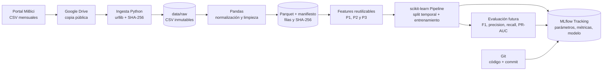

# Arquitectura propuesta

| Componente | Herramienta | Justificación |
|---|---|---|
| Fuente | Portal MiBici + Drive público | Fuente oficial y copia compartida por el equipo |
| Ingesta | Python estándar | Automatizable, portable y sin credenciales para archivos públicos |
| Almacenamiento | CSV crudo + Parquet procesado + manifiesto SHA-256 | Conserva la fuente, escala a millones de filas e identifica la versión exacta |
| Procesamiento | pandas | Adecuado al volumen del baseline y compatible con los CSV/tablas del proyecto |
| Modelado | Pipeline de scikit-learn | Encapsula transformaciones y evita ajustarlas con datos de prueba |
| Tracking | MLflow local | Registra parámetros, métricas, artefactos, modelo y commit de cada ejecución |
| Versionado | Git/GitHub Flow | Ramas cortas, Conventional Commits, Pull Requests y revisión cruzada antes de `main` |

La ingesta procesada ya usa Parquet. Para escalar más, la agregación puede migrar a
DuckDB/Spark sin cambiar el contrato de features ni el tracking de MLflow.
