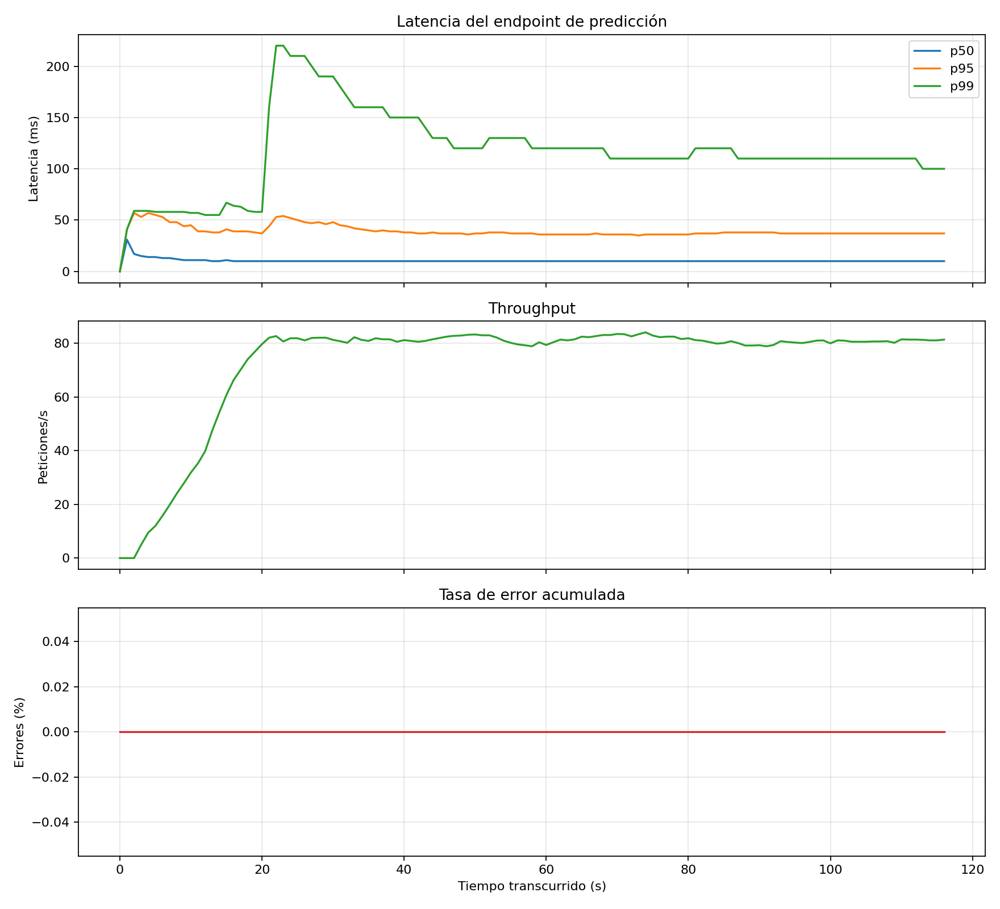
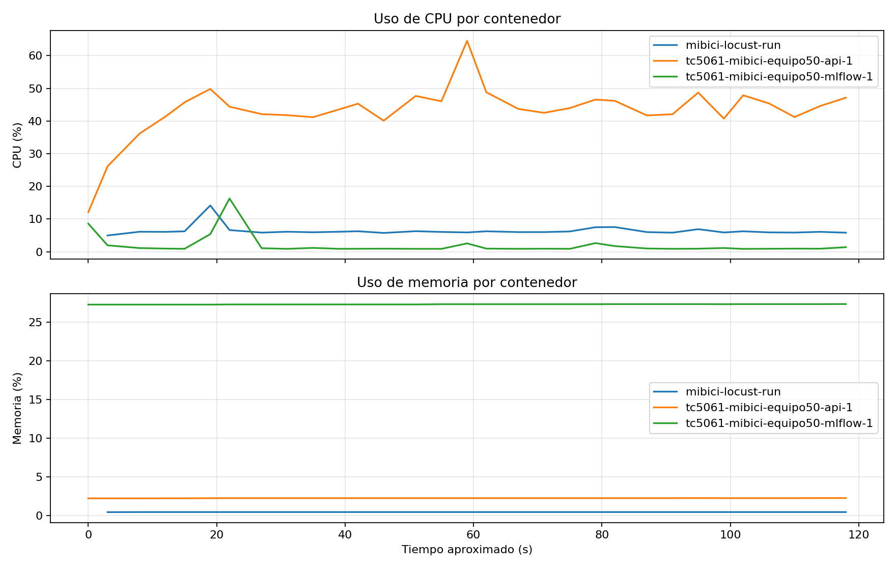

# Reporte de prueba de carga MiBici

## Escenario

- Endpoint: `POST /predict`
- Usuarios concurrentes: **50**
- Tasa de arranque: **5.0 usuarios/s**
- Duración configurada: **2m**
- Espera por usuario: **0.2 a 1.0 segundos**
- Datos: cinco estaciones tomadas del ejemplo de serving del modelo P2

## Resultados

| Métrica | Resultado |
|---|---:|
| Peticiones | 9361 |
| Fallas | 0 |
| Tasa de error | 0.000% |
| Peticiones/s | 78.44 |
| Latencia promedio | 14.62 ms |
| Latencia p50 | 10.00 ms |
| Latencia p95 | 37.00 ms |
| Latencia p99 | 100.00 ms |

Objetivos provisionales: p95 ≤ 500 ms y tasa de error ≤
1.00%. **Veredicto: PASA.**

## Recursos de contenedores

| Contenedor | CPU promedio | CPU máxima | Memoria promedio | Memoria máxima |
|---|---:|---:|---:|---:|
| `mibici-locust-run` | 6.40% | 14.15% | 0.47% | 0.47% |
| `tc5061-mibici-equipo50-api-1` | 43.18% | 64.54% | 2.27% | 2.28% |
| `tc5061-mibici-equipo50-mlflow-1` | 1.99% | 16.26% | 27.32% | 27.35% |

## Interpretación

Los resultados describen únicamente esta carga, esta máquina y la ruta local de red.
Antes de atribuir un límite a la API se debe comprobar que Docker Desktop y el contenedor
generador de Locust no estén saturados. El HTML de Locust y los CSV de esta carpeta
conservan el detalle para auditoría.
